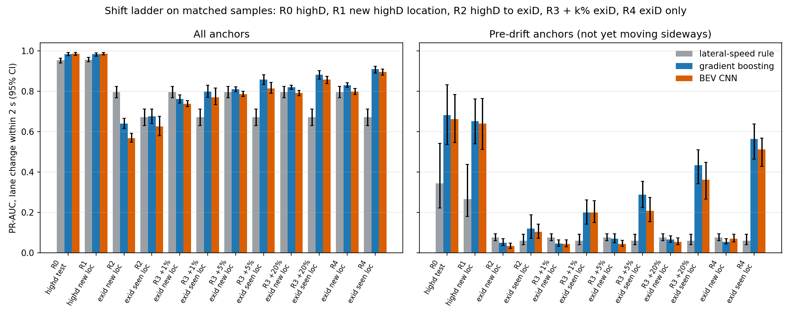
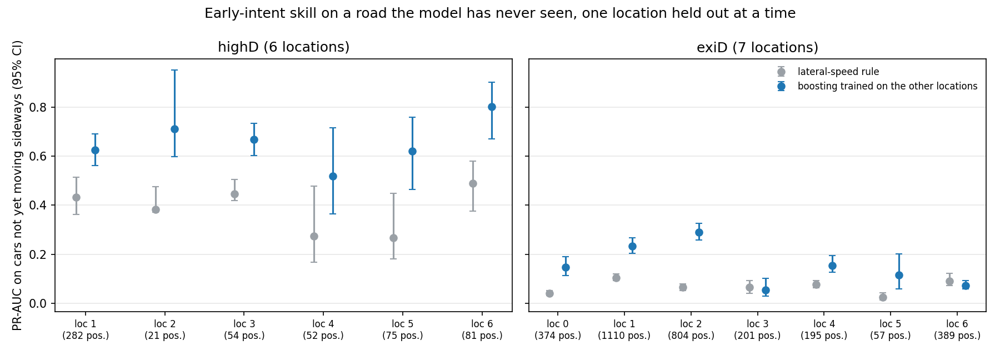
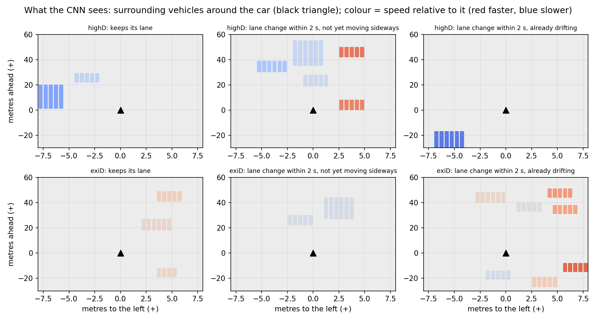
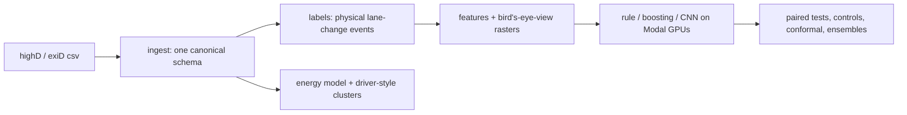
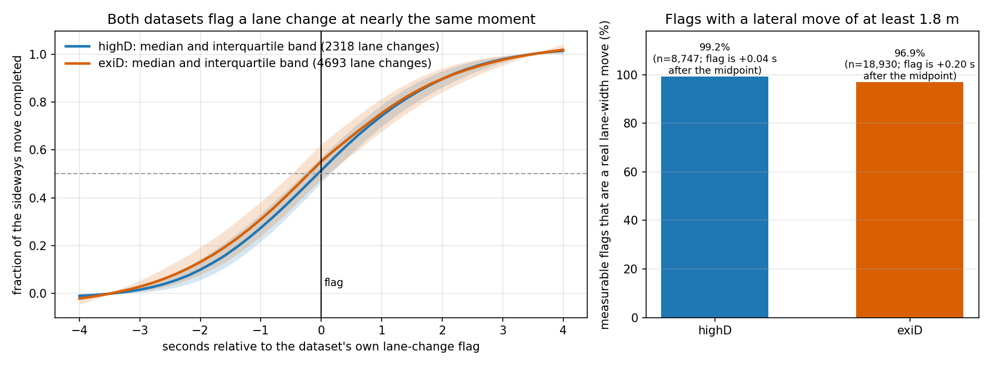

# Predicting highway lane changes before they start

**A careful, reproducible evaluation of lane-change prediction on two drone datasets (highD and exiD), including how it breaks on roads it hasn't seen.**

When a driver on a highway is about to change lanes, can a model tell *before* the car starts moving sideways? I built the full pipeline on 153 real drone
recordings (about 905,000 samples), then tried to break my own results: strong simple baselines, shuffled-label controls, leave-one-location-out, label
sensitivity sweeps, paired tests with multiple-comparison correction, and a from-scratch reproducibility check.

> The data are trajectory tables, not camera video. The "vision" part is a bird's-eye-view raster built from the trajectories and fed to a small CNN.

## What I found

- **Most lane changes are easy.** A one-line rule on lateral speed already scores 0.95 PR-AUC on highD (models: 0.98 to 0.99), because the car is usually already drifting.
  So I evaluate separately on cars that have **not yet moved sideways**, where the real difficulty is.
- **Early intent is learnable on familiar roads.** On those cars, boosting scores 0.68 (95% CI 0.54 to 0.83) against 0.34 for the rule, and it beats the rule at all six highD
  locations when each is held out in turn.
- **It does not carry over to new roads.** A highD-trained model scores 0.64 on new exiD locations, below the one-line rule (0.80). A little target data repairs most of
  the overall score (+5% of exiD: 0.86 vs 0.91 trained on exiD alone), much less of the early-intent score.
- **A bigger model did not help.** A tuned CNN was significantly worse than boosting in 13 of 24 paired comparisons and better in none. A two-stage hierarchy hurt too
  (all five forms tried). Stacking the rule, boosting and CNN gave small real gains (+0.01 to +0.04), mostly when calibrated on a little target data.
- **Uncertainty breaks under shift, and is repairable.** Conformal prediction covers 88 to 89% of real lane changes in-domain (90% target), 64 to 66% after the shift to
  exiD, and about 90% again when recalibrated on a little exiD data.

*PR-AUC at 2 s with 95% bootstrap intervals over recordings. Left: all cars. Right: cars not yet moving sideways. R0 to R4 go from in-domain highD to highD-trained
models on exiD, to adding 1%, 5%, 20% of exiD, to exiD only.*

*How hard a new road is depends on the road: early-intent skill ranges from 0.05 to 0.29 across exiD locations. The two locations I first held out were the two hardest.*

## What the model sees

## How it is built

- **Ingest** maps both datasets to one schema (centred boxes, y-up, a continuous lane-relative lateral coordinate).
- **Labels** define a lane change physically (at least 1.8 m of lateral movement, timed at the crossing midpoint), with censoring handled explicitly.
- **Models**: a lateral-speed rule, gradient boosting, a bird's-eye-view CNN (trained on Modal), stacks and hierarchies on top.
- **Evaluation**: recording- and location-disjoint splits, cluster bootstrap, paired tests with Holm correction, conformal prediction, scenario mining, and a physical EV
  energy model (modelled, not measured).
- Everything tunable lives in `configs/`; nothing is hardcoded in `src/`.

## How I kept it honest

Controls and checks: shuffled labels, validation-only tuning, leave-one-location-out, sensitivity to the label definition and to the "not yet moving" cutoff, 5000-resample
paired tests, exact re-derivation of data products from the raw files, 53 tests (including end-to-end runs on synthetic highD and exiD files).

**Mistakes I found in my own work, and fixed** (details in [docs/DECISIONS.md](docs/DECISIONS.md)):
1. A lateral-motion feature built on `heading` was near zero in exiD by construction (its heading follows the velocity), which made the first transfer results look catastrophic.
2. I then "found" a label mismatch between the datasets, twice, using methods that fail on curved roads. A proper lane-relative audit shows the two datasets' flags agree
   (99.2% and 96.9% are real lane-width moves; the flags sit within 0.2 s of each other).
3. A shuffled-label CNN scored above chance on one seed; running more seeds showed an untrained network can align with lateral speed by chance, so that control is noisy on
   all anchors (but tight on the early-intent subset that carries the headline claims).

## What this does not show
- Early intent on **new roads**: nothing here solved it. My guess is that it needs road-layout information the inputs lack; I have not tested that.
- That deep models cannot help: my CNN is small and my baselines are not the strongest in the literature ([docs/RELATED_WORK.md](docs/RELATED_WORK.md)).
- The early-intent numbers rest on few positives (75 in highD) and depend on the "not yet moving" cutoff.
- Real energy use: the energy numbers are modelled with assumed vehicle parameters and have no ground truth.
- Novelty: the methods are standard; the value is in the evaluation. See the related-work notes for what already exists.

## Reproduce
Data are not in this repo (licence). Put the extracted csv and png files under `data/highd` and `data/exid`, then follow the steps in [docs/RESULTS.md](docs/RESULTS.md#reproduce).
`pip install torch && pip install -e ".[dev]"` then `python -m pytest` runs the 53 tests on synthetic data. GPU training uses [Modal](https://modal.com).

## Data and credits
The datasets are **not redistributed here**. highD is described in [arXiv:1810.05642](https://arxiv.org/abs/1810.05642); exiD is distributed from
[exid-dataset.com](https://www.exid-dataset.com/). Obtain both from their official sources and check their terms of use. This repository contains only code and
aggregate results and figures derived from the data, no per-vehicle data. GPU training was done on [Modal](https://modal.com).

## Where to read more
[docs/RESULTS.md](docs/RESULTS.md) (all tables and caveats) | [docs/DECISIONS.md](docs/DECISIONS.md) (every decision and correction) |
[docs/BLUEPRINT.md](docs/BLUEPRINT.md) (the design) | [docs/RELATED_WORK.md](docs/RELATED_WORK.md) (positioning)
