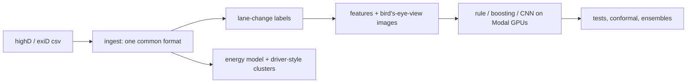

# Highway lane-change prediction

I trained models to predict a lane change on a highway before the car starts moving sideways, using two drone datasets (highD and exiD).

## What I did
- Put 153 drone recordings (about 905,000 samples) from highD and exiD into one common format.
- Labelled a lane change as a real event: at least 1.8 m of sideways movement, timed at the moment the car crosses the lane line.
- Built three kinds of models: a one-line rule on lateral speed, gradient boosting, and a small CNN that looks at a bird's-eye-view picture built from the trajectories.
- Tested everything on recordings and locations the models had not seen, and checked how the results change when the model is moved from highD to exiD.
- Added conformal prediction for uncertainty, ensembles of the models, driver-style clusters and a simple EV energy model.

## Results
- The rule on lateral speed already gets 0.95 PR-AUC on highD (the models get 0.98 to 0.99), because most cars are already drifting sideways.
- On cars that have not started moving sideways yet, boosting gets 0.68 PR-AUC against 0.34 for the rule, and it beats the rule at all six highD locations when each is held out.
- A highD-trained model gets 0.64 on the new exiD locations, below the rule (0.80). Adding 5% of exiD data brings the overall score to 0.86 (0.91 when trained only on exiD).
- The CNN was worse than boosting in 13 of 24 paired comparisons and better in none.
- Conformal prediction covered 88 to 89% of lane changes on highD (target 90%), 64 to 66% on exiD, and about 90% again after recalibrating on a little exiD data.

*PR-AUC at 2 s. Left: all cars. Right: cars not yet moving sideways. R0 to R4 go from highD only, to highD models on exiD, to adding 1%, 5% and 20% of exiD, to exiD only.*

## How it was built

## Tech stack
Python, PyTorch, scikit-learn, pandas, NumPy, SciPy, matplotlib, Modal (GPU training), pytest.
