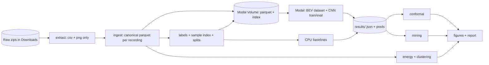

# hwtransfer: Blueprint

Highway maneuver prediction, uncertainty, scenario mining and energy modelling on highD and exiD.

Status: design only. No result in this document has been measured. Every number below is a configuration value, a hypothesis, or a quantity to be measured in Phase 0.

**Sections collapsed for a research repo (rules 1 to 7 still apply):** API design (no service), event architecture (none), LLM architecture (no LLM is used), frontend (figures only), authn/authz (single user; the only access control is the dataset licence), deployment (Modal jobs, no servers). Reason: this is an offline experiment pipeline, not a product.

---

## 1. Executive summary

Two public drone-recorded driving datasets are on disk: **highD** (60 recordings, German highways, 25 Hz) and **exiD** (92 recordings, entries and exits, 25 Hz). They are *trajectory tables plus one aerial background image per recording*, not video. The "vision" in this project is therefore a **bird's-eye-view (BEV) raster built from the trajectories**, fed to a small CNN. This must be stated plainly in any write-up.

Four studies share one data pipeline:

| # | Study | Question | Primary output |
|---|---|---|---|
| S1 | Transfer | How much does a lane-change predictor trained on highD lose on exiD, and what recovers it? | Shift-ladder table with CIs |
| S2 | Uncertainty | Does conformal prediction keep its coverage guarantee under that shift, and does a small target calibration set restore it? | Coverage and set-size table |
| S3 | Mining | Do learned scene embeddings retrieve safety-critical scenario types better than raw features and simple rules? | Retrieval mAP@k table |
| S5 | Energy | Given a physical EV model, how much do driving-style clusters differ in energy per km after controlling for speed? | Wh/km by cluster, sensitivity analysis |

Key technical challenges: (a) lane-change labels come from different fields in the two datasets, (b) frames from one track are not independent, so naive splits leak, (c) lane changes are rare, (d) conformal guarantees assume exchangeability, which shift breaks, (e) energy has no ground truth in either dataset.

---

## 2. Requirements

| ID | Requirement | Tag |
|---|---|---|
| F1 | Ingest both datasets into one canonical schema without hand-editing raw files | must |
| F2 | Produce harmonised lane-change labels (none / left / right within horizon H) for both datasets, validated | must |
| F3 | Group-wise splits (by recording, and by location) with no track or recording in two splits | must |
| F4 | Baselines: class prior, constant-lateral-velocity rule, gradient boosting on kinematics | must |
| F5 | BEV CNN trained on Modal GPU, evaluated on the shift ladder | must |
| F6 | Fine-tune on k% of target data, k from config | must |
| F7 | Split conformal prediction with class-conditional coverage; evaluate under shift | must |
| F8 | Scenario tagging by deterministic rules, embedding retrieval, comparison to baselines | should |
| F9 | Physical EV energy model, driver-style clustering, sensitivity analysis | should |
| F10 | Every run writes config, git SHA, seed, metrics JSON to a results folder | must |
| F11 | Optional map channel from exiD map files | could |
| N1 | Reproducible: same config and seed gives same metrics within stated tolerance | must |
| N2 | Cost: a hard GPU-minute cap per Modal run, set in config | must |
| N3 | Token and time frugality: each phase is independently stoppable | must |
| N4 | No dataset content committed or redistributed (licence) | must |
| N5 | Windows-safe: short root path, UTF-8 forced, no shell-only tooling | must |

---

## 3. Actors

| Actor | Responsibility |
|---|---|
| Researcher (Sriya) | Chooses configs, reads results, decides on REQUIRES USER DECISION items |
| Coding agent | Builds and runs phases, reports real outcomes including failures |
| Modal worker | Runs GPU training/eval jobs from a pinned image |
| Local runner | Runs ingest, labels, CPU baselines, energy, figures |

---

## 4. Architecture



Design choice: **modular monolith as a Python package plus a thin Modal entrypoint.** No services, no DB server, no queue. Alternatives rejected in ADR-1.

---

## 5. Component design

| Component | Responsibility | Inputs | Outputs | Must NOT |
|---|---|---|---|---|
| `config` | Load and validate YAML into typed models | YAML, CLI overrides | frozen config object | Read env for anything but paths/tokens |
| `ingest` | Map each dataset's columns to the canonical schema | raw csv | parquet per recording | Compute labels or features |
| `labels` | Lane-change events, per-sample labels, scenario tags | canonical parquet | sample index parquet | Look at splits |
| `splits` | Deterministic group-wise assignment | recording metadata | split table | Shuffle by frame |
| `bev` | Rasterise neighbours into ego frame | scene rows, ego row | array (C,H,W) | Read files itself |
| `datasets` | Torch Dataset that joins index to scene rows and calls `bev` | index, parquet | tensors | Do augmentation by default |
| `models` | HGB wrapper, CNN, embedding head | tensors | logits, embeddings | Hold training loop |
| `train` | Training and fine-tuning loops, early stopping on val | datasets, config | checkpoints, preds | Touch test split |
| `eval` | Metrics, cluster bootstrap CIs | preds, labels | metrics JSON | Recompute labels |
| `conformal` | Calibration, prediction sets, coverage | preds (cal/test) | sets, coverage tables | Use the test split to pick the threshold |
| `mining` | Tagging check, embeddings retrieval | embeddings, tags | mAP@k tables | Use tag rules as model input |
| `energy` | Power model, per-track energy, clustering | canonical parquet | Wh/km table, clusters | Claim measured consumption |
| `viz` | Figures | results | PNG | Compute metrics |

State: all state lives in files (parquet, JSON). No in-memory state survives a run.

---

## 6. Data architecture

### 6.1 Canonical scene table (one parquet per recording)

| Field | Type | Req | Notes |
|---|---|---|---|
| dataset | category | yes | `highd` or `exid` |
| recording_id | int | yes | unique within dataset; global key is (dataset, recording_id) |
| location_id | int | yes | highD from recordingMeta; exiD `locationId` |
| track_id | int | yes | |
| frame | int | yes | 25 Hz in both (verified in exiD meta; verify highD in Phase 0) |
| x, y | float32 m | yes | **centre** of box. highD x,y are the top-left corner, so add width/2 and height/2 (verify in Phase 0) |
| heading | float32 rad | yes | exiD given; highD derived from velocity direction and `drivingDirection` |
| vx, vy | float32 m/s | yes | world frame |
| ax, ay | float32 m/s² | yes | as given in the dataset |
| length, width | float32 m | yes | |
| cls | category | yes | car, van, truck, motorcycle, other |
| lane_key | int | yes | opaque per dataset (highD `laneId`, exiD `laneletId`); never compared across datasets |
| lc_flag | bool | yes | lane-change event pulse (see ADR-4) |
| ttc, thw | float32 | no | highD `ttc`,`thw`; exiD `leadTTC`,`leadTHW`; NaN when no leader |
| lead_id | int | no | |

Key: (dataset, recording_id, track_id, frame), unique. Validation on write: no duplicate keys, frames contiguous per track, speeds below a config sanity bound, heading within [-π, π].

### 6.2 Sample index

| Field | Type | Notes |
|---|---|---|
| sample_id | int64 | |
| dataset, recording_id, location_id, track_id, frame | | ego anchor |
| y3 | int8 | 0 keep, 1 left, 2 right |
| ttl | float32 | seconds to the event, NaN if none (for lead-time analysis) |
| horizon_s | float32 | label horizon used |
| split | category | train/val/cal/test per split scheme |
| tags | bitmask int | scenario tags (S3) |

### 6.3 Lifecycle and ownership

Raw zips (read-only, outside the repo) → extracted csv/png (`data/`, gitignored) → canonical parquet (derived, rebuildable) → sample index (derived) → results (small JSON/CSV committed; large prediction files gitignored). Source of truth: the raw zips. Everything else is regenerable from config.

Versioning: each derived file carries `schema_version` and the config hash in parquet metadata; a mismatch fails loudly.

---

## 7. Data flow and key scenarios

Per-sample label construction (ADR-3, ADR-4):

1. Sample anchor at frame t of track k, taken every `sample_stride` frames after `history_s` seconds of history.
2. Require the track to continue at least `horizon_s` beyond t (otherwise the future is **censored**; the sample is dropped, not labelled "keep").
3. Find the first event pulse in (t, t + H]. If none, label keep.
4. Direction: sign of lateral displacement in the ego frame between t and the event frame.
5. Samples inside `exclude_after_event_s` after an event are dropped (the manoeuvre is already happening).

Failure and edge cases are handled in §18 and the failure matrix.

---

## 8. to 10. API, events, state

Not applicable (see top). The only "interface" is the CLI: `python -m hwt <stage> --config configs/<name>.yaml`, one stage per command, each idempotent: it recomputes only when the output's config hash differs.

---

## 11. ML architecture

### 11.1 Problem formulation
Multi-class early manoeuvre prediction, classes {keep, left, right}, at lead times derived from H ∈ {1, 2, 3} s. One model per H is trained; ADR-6 explains why not one multi-horizon model first.

### 11.2 Inputs
- **Scalar features (available in both datasets, physically defined):** speed, longitudinal and lateral acceleration in ego frame, lateral velocity, heading rate, time headway to leader, relative speed to leader, vehicle class, over the last `history_s` seconds subsampled at `hist_step_s`.
- **Lateral offset to lane centre** is given in exiD but **not in highD**. It must be computed for highD from the lane-marking positions in `recordingMeta` (Phase 0 task). Until that is verified and tested, it is excluded from the shared feature set so that the shared set stays honest.
- **BEV raster** (ADR-5): ego-aligned, config extent (default: 60 m ahead, 30 m behind, ±10 m lateral), config cell size (default 1.0 m × 0.5 m → 90 × 40), channels: neighbour occupancy now, relative longitudinal speed, relative lateral speed; optional occupancy at t−1 s and t−2 s for motion. No map channel in the main runs, so the transfer study measures what is learnable *without* lane geometry. A map channel is the F11 ablation.

### 11.3 Models

| Model | Purpose |
|---|---|
| Class prior | floor |
| Constant-lateral-velocity rule (predict a change if the lateral drift projects across the lane boundary within H) | physics baseline, answers "does anything beyond drift matter" |
| HistGradientBoosting on scalar features | strong tabular baseline, CPU |
| Small CNN (3 to 4 conv blocks) + scalar MLP, fused | main model; embedding = penultimate layer |
| Same CNN, fine-tuned on k% of target | transfer remedy |

Loss: cross-entropy with class weights from the training split (config). Calibration of the *scores* is not assumed; conformal (§13) handles uncertainty, and ECE/Brier are reported.

### 11.4 Shift ladder (the core experimental design)

| Rung | Train | Test | What it isolates |
|---|---|---|---|
| R0 | highD recordings (train) | highD recordings (test, same locations) | in-domain ceiling |
| R1 | highD, locations A | highD, held-out location B | new road, same sensor and country |
| R2 | highD | exiD held-out locations | new dataset, new road type |
| R3 | highD + k% exiD | exiD held-out locations | transfer remedy, k ∈ config (e.g. 1, 5, 20) |
| R4 | exiD only | exiD held-out locations | target in-domain ceiling |

### 11.5 Metrics
Primary: **PR-AUC (macro over left/right vs keep) at H = 2 s**, reported next to the prevalence baseline. Secondary: per-class recall at fixed precision, Brier, ECE, accuracy by time-to-event bucket. All with **cluster-bootstrap 95% CIs resampling recordings**, and 3 seeds for neural models.

### 11.6 Monitoring and fallback
No deployment, so no drift monitoring. Training aborts on NaN loss, on val metric not improving for `patience` epochs, or on the GPU-minute cap.

---

## 12. LLM architecture
Not applicable. No LLM is used.

---

## 13. Algorithms

### 13.1 BEV rasterisation
Rotate neighbours into the ego frame by −heading, translate to ego centre, rasterise each neighbour's oriented rectangle (length × width) into cells by polygon fill (or centre-point splat with the footprint if polygon fill is too slow; decision made by a timing test in Phase 3). Complexity O(neighbours × footprint cells). Edge cases: neighbour partly outside the window is clipped; missing neighbour rows contribute nothing; ego excluded from its own raster.

### 13.2 Split conformal prediction (S2)
- Score: LAC, s = 1 − p̂(true class). Prediction set = {c : p̂(c) ≥ 1 − q̂}.
- **Class-conditional (Mondrian)** thresholds per true class, because left/right are rare and marginal coverage can hide zero coverage on them.
- Calibration set: a recording-disjoint split, never the test set. Frames from one track are not exchangeable, so the calibration/test unit is the recording, and effective sample size is reported by number of tracks.
- Scenarios evaluated: (i) exchangeable (R0 cal on R0 test), (ii) shifted (R0 cal on R2 test), (iii) repaired (small exiD cal set on exiD test), (iv) optionally covariate-shift-weighted conformal using a domain classifier.
- Reported: marginal and per-class coverage with CIs, mean set size, fraction empty sets. A coverage collapse under (ii) is an expected, publishable result, not a failure. **If the exiD calibration set has too few left/right events (< `min_events_per_class`, config), that class is reported as "not estimable", never guessed.**

### 13.3 Scenario tags (deterministic ground truth for S3)
Rules from dataset signals, thresholds in config, never in code: `close_following` (THW below t1), `critical_ttc` (TTC below t2), `hard_brake` (ax below −a1), `cut_in_ahead` (another vehicle's lane-change event ends in front of ego within d metres), `ego_lane_change`. A tag may be missing for rare ones; counts are reported before any retrieval claim.

### 13.4 Mining protocol (S3)
Query-by-example: pick n_query scenes of a tag, retrieve top-k from a held-out pool by cosine similarity, score tag precision@k and mAP over tags. Embedding sources compared: raw-BEV PCA, scalar-feature standardised vector, CNN embedding (trained for lane-change, so its embedding is biased toward lane-change tags; this is noted, and a randomly initialised CNN is the control). Baselines: random, and the rule itself (which is an upper-bound reference, not a competitor, since it defines the tag). Cross-dataset variant: embed with the highD-trained CNN, retrieve in exiD.
This ties to `driving-geometry`'s curation study, which scores by held-out scenario tags; the metric code should be shared, not copied (see ADR-9).

### 13.5 Energy model (S5)
Per track, per frame, for vehicle mass m, drag area CdA, rolling coefficient Crr, air density ρ, flat road (no elevation in either dataset, stated as an assumption):

- F = m·a + ½·ρ·CdA·v² + Crr·m·g
- P_wheel = F·v
- P_batt = P_wheel / η_drive when P_wheel > 0; P_batt = P_wheel·η_regen when P_wheel < 0 (regen fraction and power cap from config) ; plus constant auxiliary load.
- Energy = ∫P_batt dt, normalised by distance → Wh/km.

Parameters come from named **vehicle profiles in config**, labelled "assumed typical values", with a sensitivity sweep (±20% on each) reported next to every headline number. Cars (and vans if profile given) only; trucks are excluded because a car profile would be wrong for them.
Acceleration source: dataset-provided acceleration vs acceleration from a smoothed speed (Savitzky–Golay, window in config). Noise in differentiated tracking data inflates energy, so both are run and the gap is reported.
Driver-style features per track: mean and std of speed, 95th percentile of |a|, jerk RMS, mean THW, lane-change count, time spent above speed limit (from meta where available). Clustering: standardise, GMM or k-means, k chosen by silhouette **and** bootstrap stability (adjusted Rand index), not silhouette alone. Test: regression of Wh/km on mean speed plus cluster label, to see whether style matters beyond speed.
**What this study cannot claim:** real consumption. Wh/km is a modelled quantity. If `evprior`'s real EV data is used to calibrate the profile (REQUIRES USER DECISION D3), the calibration set and test set are separate.

---

## 14. Frontend
Figures only (matplotlib PNG). No UI.

## 15. Background jobs
Modal functions: `train`, `eval`, `embed`. Trigger: CLI. Timeout and GPU-minute cap from config. Retry: none automatic for training (a failed run is reported, not silently repeated); data upload is retried by re-running the idempotent upload command.

---

## 16. Security
- **Licence:** highD and exiD are for non-commercial research and must not be redistributed. The repo never contains raw or derived per-vehicle data; `.gitignore` covers `data/` and `results/preds/`. Aggregate tables and figures are fine to publish subject to the licence text (D4: read it before any public push).
- Secrets: Modal tokens stay in `~/.modal.toml`; never in config or logs.
- Dependencies pinned in the Modal image and in `requirements.txt`.
- No network service is exposed.

## 17. Observability
Per run: `run.json` (config, hash, git SHA, seed, library versions, wall time, GPU minutes), `metrics.json`, loss curves CSV, and counts at every filter step (rows in, rows dropped and why). Counts-at-each-step is the main debugging tool for label and leakage bugs. Alert: none; failures print a one-line cause and exit non-zero.

## 18. Error handling

| Error | Behaviour |
|---|---|
| Missing/renamed column | Ingest fails naming file and column, writes nothing |
| Duplicate or non-contiguous frames | Fail with the track ids; no silent repair |
| Track shorter than history + horizon | Drop sample, count in the step log |
| Future beyond track end (censoring) | Drop sample, count |
| NaN in features | Training fails; no silent imputation. Documented imputation only where a column is legitimately NaN (e.g. no leader) |
| Split overlap detected | Hard fail in a split-integrity check run before every train |
| Modal timeout or cap hit | Save last checkpoint and partial metrics, flag run `incomplete`, never report it as final |
| Windows encoding error from Modal CLI | `PYTHONUTF8=1` set by the CLI wrapper |

---

## 19. Testing
- **Unit:** BEV on hand-made scenes (a car exactly 10 m ahead lands in the expected cell; rotation by 180° mirrors it); label builder on synthetic tracks (event in window, event just outside, censored); energy model closed forms (constant speed gives pure drag + rolling; zero speed gives zero; braking returns energy only up to the regen cap); conformal on synthetic exchangeable data (empirical coverage within binomial tolerance of 1−α).
- **Integration:** ingest → labels on one real recording; assert schema, key uniqueness, and that the rolled-back label count matches the raw event count.
- **Leakage tests:** no track, recording, or location appears in two splits; calibration disjoint from test.
- **Property test:** randomising frame order inside a track must not change the labels.
- **Failure injection:** drop a column, duplicate a frame, truncate a track.
- **ML evaluation tests:** a model fed shuffled labels must score at the prevalence baseline (guards against pipeline leakage).
- **Perf:** timing test of the rasteriser at the configured resolution.

## 20. Performance and cost
Bottlenecks: reading about 10 GB of CSV (do once, parquet after), on-the-fly rasterisation (CPU-bound, so use multiple dataloader workers and benchmark), Modal volume upload (parquet only, not raw). Scale targets are config values (`max_samples_train`, `max_gpu_minutes`); no invented numbers. If rasterisation limits throughput, pre-rasterise a capped subset into uint8 shards (fallback in the roadmap).

## 21. Configuration

| Parameter group | Source | Examples |
|---|---|---|
| Paths | YAML + env override | raw dir, data dir, results dir |
| Data | YAML | horizon list, history, stride, exclusion windows, speed bounds |
| BEV | YAML | extents, cell size, channel list |
| Splits | YAML | seed, ratios, held-out locations |
| Model/train | YAML | widths, lr, epochs, patience, class weights, seeds |
| Transfer | YAML | list of k values |
| Conformal | YAML | alpha, min_events_per_class, score type |
| Tags | YAML | all thresholds |
| Energy | YAML profiles | mass, CdA, Crr, η_drive, η_regen, regen cap, aux load |
| Budget | YAML | max_gpu_minutes, max_samples |
| Secrets | `~/.modal.toml` only | Modal token |

Validated by pydantic at load; unknown keys are an error. Changing a value never needs a code change; only Modal image changes need a rebuild.

---

## 22. Repository structure

```
hwtransfer/
  README.md
  pyproject.toml            # package + pinned deps, ruff and pytest config
  requirements-modal.txt    # image deps for the GPU worker
  configs/
    base.yaml               # defaults, every parameter documented
    ladder.yaml             # shift-ladder runs
    energy.yaml             # vehicle profiles
  src/hwt/
    cli.py                  # stage dispatch
    config.py
    ingest/{highd.py,exid.py,schema.py}
    labels.py  splits.py  tags.py
    bev.py  datasets.py
    models/{baselines.py,cnn.py}
    train.py  eval.py  conformal.py  mining.py  energy.py  viz.py
    modal_app.py            # Modal entrypoints only, no logic
  tests/
  docs/{BLUEPRINT.md,DECISIONS.md,RESULTS.md}
  data/                     # gitignored: raw, interim, canonical
  results/                  # small json/csv committed; preds gitignored
```
Belongs elsewhere: `ingest/*` holds *only* column mapping; `modal_app.py` holds *only* Modal wiring; no `if dataset == ...` branches outside `ingest/`.

## 23. Dependencies

| Package | Why | Alternative |
|---|---|---|
| pandas + pyarrow | CSV and parquet; per-recording sizes are modest | polars (faster; adds a dependency, not needed yet) |
| numpy, scipy | arrays, Savitzky–Golay, stats | none |
| scikit-learn | HistGradientBoosting, GMM, metrics (no extra GBM library) | LightGBM |
| torch (Modal image only) | CNN | CPU torch locally is optional |
| pydantic + pyyaml | validated config | Hydra (heavier than needed) |
| matplotlib | figures | none |
| modal | GPU | Kaggle, Lightning (rejected: not scriptable from a terminal) |
| pytest, ruff | tests, lint | none |

Rejected as unnecessary: MLflow/W&B (JSON files suffice), Lightning (a 60-line loop is clearer), Docker (Modal builds the image).

## 24. Local development (Windows)
Prereqs: Python 3.13 (present), `modal` installed and authenticated (done). Short root path `C:\Users\sriya\hwtransfer` is deliberate (Windows long-path failures were hit earlier). Commands: `pip install -e .`, `pytest`, `python -m hwt ingest --config configs/base.yaml`, Modal runs via `PYTHONUTF8=1 python -m modal run src/hwt/modal_app.py`. Raw data is already extracted under `data/highd` and `data/exid` (csv and png only; the `.osm/.xodr/.fbx/.osgb` files were skipped).

## 25. Deployment
None. Modal functions run from the CLI with a pinned image; results copied back with `modal volume get`. Rollback = rerun an earlier config hash.

---

## 26. Failure and recovery matrix

| Component | Failure | Detection | Retry | Fallback | Recovery |
|---|---|---|---|---|---|
| ingest | schema drift | column check | no | none | fix mapping, rerun (idempotent) |
| labels | event definition disagrees across datasets | Phase 0 agreement test | no | stricter geometric definition (ADR-4) | re-derive labels, rerun |
| splits | leakage | integrity check | no | none | fix, retrain |
| Modal upload | interrupted | volume listing vs manifest | yes (resumable put) | none | rerun upload |
| training | NaN, cap hit | loss check, timer | no | last checkpoint flagged incomplete | lower lr or raise cap deliberately |
| rasteriser | too slow | timing test | no | pre-rasterised shards | switch via config |
| conformal | too few events | count gate | no | report "not estimable" | gather more recordings |
| energy | unrealistic Wh/km | range sanity test | no | none | check units, acceleration source |
| results | stale | config hash mismatch | no | none | rerun stage |

## 27. Threat model
Realistic threats only: (1) **accidental redistribution of licensed data** (mitigation: gitignore, pre-push check); (2) **leaked Modal token** (kept in the user config, not the repo); (3) **supply chain via the community Colab MCP**: not used; the earlier candidate had no authentication and is out of scope; (4) **silent data corruption** (hashes in manifests).

---

## 28. Roadmap

| Phase | Objective | Acceptance (checkable) |
|---|---|---|
| **P0 Audit** (CPU, cheap) | Resolve the open facts before any model | (a) highD x,y confirmed as corner by overlay on a background PNG; (b) both frame rates confirmed; (c) exiD `lc_flag` pulse width and meaning checked against lateral-offset jumps, agreement % recorded; (d) event counts per dataset, location and direction written to `docs/AUDIT.md`; (e) highD lane-centre offset computed from lane markings and checked against geometry; **gate:** if exiD events < `min_events_per_class` for any class, S1 R3 and S2 repair are re-scoped (REQUIRES USER DECISION) |
| P1 Ingest, labels, splits | Canonical parquet, sample index, split table | Unit and leakage tests green; step-wise drop counts logged |
| P2 Baselines | Prior, rule, HGB across the ladder on CPU | Results table with CIs; shuffled-label control at prevalence |
| P3 BEV + CNN | Train R0 on Modal | Beats HGB or the report states it does not; throughput benchmark done |
| P4 Transfer | R1 to R4, fine-tuning k values | Full ladder table; seeds ×3 |
| P5 Conformal | S2 scenarios (i) to (iv) | Coverage table; exchangeable case within tolerance of 1−α |
| P6 Mining | S3 | Tag counts first, then retrieval table with random and control baselines |
| P7 Energy | S5 | Closed-form tests pass; sensitivity table; cluster stability reported |
| P8 Report | `docs/RESULTS.md` + figures | Every number traceable to a `run.json` |

Each phase leaves a working increment, and you can stop after any of them.

---

## 29. Build instructions for the coding agent
1. `git init` in `C:\Users\sriya\hwtransfer`. **Commit messages carry no Co-Authored-By line** (portfolio work is under the user's name).
2. Create `pyproject.toml`, `configs/base.yaml`, empty package skeleton, tests folder.
3. Implement in roadmap order; do not start a phase before the previous acceptance holds.
4. Stable interfaces: canonical schema (§6.1), sample index (§6.2), `bev.render(scene, ego, cfg) -> np.ndarray[C,H,W]`, `Model.predict_proba(batch) -> (N,3)`. Changing one needs an ADR.
5. After each stage, print and log the step counts; verify the feature works by running it on one real recording before scaling.
6. Windows: set `PYTHONUTF8=1` in the CLI wrapper before spawning Modal.
7. Report real outcomes, including negative ones, in `docs/RESULTS.md`.

## 30. Engineering rules
Never: hardcode thresholds, paths, IDs or vehicle parameters; fake a metric or a prediction; swallow an exception; split by frame; use the test split to choose anything; add a dependency without an ADR; leave `if dataset == "exid"` logic outside `ingest/`; claim measured energy or raw-video computer vision.
Always: typed models; validate inputs and outputs; seed everything and record it; log drop counts; write the config hash with every artifact; test the leakage guards; state limitations next to the result.

## 31. Code quality
Type hints on public functions, `ruff` format and lint, `pytest` in CI-equivalent local run before each phase is called done, docstrings stating units, no module over about 400 lines.

---

## 32. Experimental validation plan

**Hypotheses (to test, not assumed):**
- H1: Performance falls monotonically down the shift ladder R0 > R1 > R2.
- H2: A modest k% of exiD recovers most of the gap (the size of the recovery is to be measured, and may be small).
- H3: The CNN adds value over HGB on the kinematic features; it may not (a null result is reported as such).
- H4: Marginal conformal coverage holds at R0 and fails at R2, with the worst failure on the rare classes; target-domain calibration restores it.
- H5: Learned embeddings beat raw-feature embeddings at few-shot tag retrieval; the random-init CNN control shows how much is architecture alone.
- H6: Driving-style clusters differ in modelled Wh/km beyond what mean speed explains.

**Controls and threats to validity**
- Shuffled labels; random-init embeddings; physics-rule baseline; class prior.
- Label definitions differ by dataset (ADR-4): checked in P0, and re-run with the stricter geometric definition as an ablation.
- Right-censoring (ADR-3) and exiD's exit manoeuvres (not lane changes in the flag sense) are documented limits.
- One country, one sensor family, limited recordings per location.
- Energy has no ground truth.

**Statistics:** cluster bootstrap over recordings (≥1000 resamples, config), 3 seeds, paired comparisons on identical test samples, effect sizes reported with CIs, no p-value hunting.

**Reproducibility:** `run.json` per run; deterministic split by hashed recording ID; pinned image.

---

## 33. Risks

| Risk | Consequence | Mitigation |
|---|---|---|
| exiD `laneChange` is not the same event as highD laneId change | transfer gap is partly a label artefact | P0 agreement test, geometric ablation |
| Too few exiD events per class | conformal and fine-tuning unstable | count gate, "not estimable" reporting |
| highD lacks lane-centre offset | shared features unbalanced | compute from markings or drop the feature |
| Rasteriser too slow | GPU idle, money wasted | benchmark first, pre-rasterised fallback |
| Frame autocorrelation | inflated metrics | recording-level splits, cluster bootstrap |
| Embeddings biased toward lane-change | S3 overstated | random-init control, tag counts |
| Energy parameters assumed | numbers mistaken for measurements | labelled assumed, sensitivity table |
| Licence breach | legal issue | no data in repo, read terms first |
| Scope too big for the budget | unfinished work | phases independently stoppable |

## 34. Architectural decision records

| ADR | Decision | Alternatives | Why / consequence |
|---|---|---|---|
| 1 | Modular Python package + thin Modal entrypoint | microservices, notebooks, Airflow | no services needed; notebooks hurt reproducibility and agent editing |
| 2 | Parquet per recording, canonical schema | keep raw CSVs, SQLite | fast column reads, typed, rebuildable from source |
| 3 | Drop right-censored samples instead of labelling them "keep" | label as keep | a vehicle leaving the recorded area did not stay in lane; labelling it keep adds noise. Cost: slight bias, documented |
| 4 | Lane-change event from lane assignment in highD and from `laneChange` pulse in exiD, validated geometrically in P0 | geometric definition only; laneletId change | native fields are the least invented option; geometric version kept as ablation. exiD lanelet IDs change at road-section boundaries too, so they are not used |
| 5 | BEV from trajectories, no map channel in main runs | include OSM/xodr map | isolates what is learnable without geometry; map is F11 ablation |
| 6 | One model per horizon | one multi-horizon head | simpler analysis of lead time; multi-horizon is a later option |
| 7 | Splits by recording and by location, never by frame | random frame split | frame split leaks within a track |
| 8 | HistGradientBoosting as tabular baseline | LightGBM, XGBoost | no extra dependency |
| 9 | Mining metric code shared with `driving-geometry` via a small common module, not copy-paste | duplicate | avoids drift between two retrieval scorers; requires reading that repo's interface first |
| 10 | Class-conditional (Mondrian) conformal | marginal only | marginal coverage can hide failure on rare classes |
| 11 | Modelled energy with named, labelled-assumed profiles + sensitivity | claim measured, skip energy | honest about missing ground truth |
| 12 | On-the-fly rasterisation, pre-rasterised shards as fallback | pre-rasterise everything | avoids huge uploads; benchmark decides |
| 13 | Modal for GPU | Colab (user preference against), Kaggle | scriptable from the terminal, already authenticated and tested |

## 35. Definition of done
Per study, all of: phase acceptance met; tests green; leakage and control checks pass; every table cell traces to a `run.json`; limitations stated beside results; no data or token in git; another developer can reproduce from `README.md` with the raw zips and a Modal account; no hardcoded thresholds; no fabricated or placeholder results.

## 36. Consistency check (performed)

| Pair | Result |
|---|---|
| Requirements ↔ architecture | every must has a component and a roadmap phase |
| Schema ↔ labels/BEV/energy | all needed fields are in §6.1 (`ttc/thw` nullable, handled) |
| Labels ↔ splits | splits operate on recording/location, labels never read split |
| Conformal ↔ splits | cal set recording-disjoint from test; explicit in §13.2 |
| Mining ↔ ML | tags use dataset signals only, never model outputs |
| Energy ↔ data | trucks excluded to match car profiles; flat-road assumption stated |
| Config ↔ code | every threshold named in §21 |
| Cost ↔ roadmap | GPU cap applies to P3 to P6; P7 and P0 to P2 are CPU |
| **Fixed during the check** | highD lacks lane-centre offset → excluded from the shared features until computed (§11.2); right-censoring added to label rules (§7) |

---

## REQUIRES USER DECISION

| ID | Decision | Default if you say nothing |
|---|---|---|
| D1 | Add the exiD map channel (needs the `.osm`/`.xodr` files, currently skipped) as an ablation | no, main runs without it |
| D2 | Include vans in the energy study (needs a van profile) | cars only |
| D3 | Calibrate EV profile parameters on real data from `evprior` | no, assumed profiles + sensitivity |
| D4 | Read the highD/exiD licence terms before any public push | repo stays private until read |
| D5 | Per-run GPU-minute cap | 30 minutes |
| D6 | If the P0 gate fails (too few exiD events), which study to shrink | drop the 20% fine-tune rung first |
